# Process

The whole pipeline as one flow: who does each step (you, a command, a workflow),
what each hand-off carries, and where the flow has gaps. The stages themselves are
described in the [README](../README.md#the-workflows); args and statuses are in
[REFERENCE.md](REFERENCE.md).

## Diagram

Rounded boxes are steps a workflow or command runs; hexagons are steps only a
person does; dashed red boxes are the gaps listed below the diagram that are still
open, amber ones are partly fixed, and green ones are fixed (each gap's *Status:*
line says what was done).

```mermaid
flowchart TD
  classDef human fill:#fff4d6,stroke:#b8860b,color:#000
  classDef gap fill:#fde8e8,stroke:#c0392b,stroke-dasharray:5 4,color:#000
  classDef stop fill:#eee,stroke:#888,color:#000
  classDef partial fill:#fff1dc,stroke:#d68910,stroke-dasharray:5 4,color:#000
  classDef fixed fill:#e6f4ea,stroke:#1e8449,color:#000

  subgraph INSTALL["Install / update (any repo)"]
    clone{{"Clone a repo with origin<br/>(new product: a first commit on main)"}}:::human
    start("/start-product brief repo<br/>verdict check, brief + builder context,<br/>setup checklist")
    seed("/seed or pipeline-sync.py<br/>.claude files + manifest,<br/>base CLAUDE.md")
    upd("pipeline-sync.py --update<br/>or pipeline-update.yml PR")
    clone -- "new product" --> start
    clone -- "existing repo" --> seed
    seed -. "later" .-> upd
  end

  subgraph DESIGN["Design: brief-to-proposals, checkpointed on design/date"]
    intake("Intake: blocking questions?")
    ask{{"Answer questions<br/>re-run with answers and from"}}:::human
    panel("Architecture panel<br/>3 sketches, judge, synthesis")
    roadmap("/roadmap<br/>architecture.md, roadmap.md")
    rrev("/review-proposal + /propose --revise<br/>until no bug/concern")
    props("/propose --milestone=N<br/>per code milestone, reviewed")
    cons("Consistency, two docs at a time;<br/>lint, lane preview")
    intake -- "needs_input" --> ask --> intake
    intake --> panel --> roadmap --> rrev --> props --> cons
  end

  accept{{"Read, edit, set Status: accepted"}}:::human
  landdesign{{"Land the design branch<br/>on main via PR"}}:::human

  subgraph BOOT["Bootstrap (greenfield only)"]
    bgates{{"Do the gates Bootstrap waits on<br/>(name, licence: tick + Outcome)"}}:::human
    boot("bootstrap-repo<br/>/bootstrap: skeleton, CI, gates green,<br/>1 commit on bootstrap/date;<br/>then plan-to-merged-pr ship_only")
    bmerge{{"Merge, protect main,<br/>add secrets, tick Bootstrap gate<br/>via docs PR"}}:::human
    bgates --> boot --> bmerge
  end

  landdocs{{"Existing repo: land .claude,<br/>CLAUDE.md and docs via PR"}}:::human

  subgraph MILESTONE["Per milestone (lint --roadmap names the next)"]
    hgates{{"Do the human gates it waits on<br/>tick + Outcome; refresh-proposal<br/>if the Outcome changes the plan;<br/>re-accept"}}:::human
    refresh("Later milestone: its proposal written<br/>(brief-to-proposals from: proposals)<br/>or refreshed (refresh-proposal), accepted")
    chain("proposal-build-chain<br/>derive lanes from origin/main")
    blocked["blocked lanes reported<br/>(gate, doc, milestone, draft)"]:::stop
    shipplan["ship_plan per chain,<br/>in merge order"]:::stop
    hgates --> refresh --> chain
    chain --> blocked
    chain --> shipplan
  end

  subgraph LANE["Lane engine: plan-to-merged-pr"]
    plan("/plan  grounded plan")
    impl("/impl  tests first")
    review("/review-changes + fixer<br/>until no bug/concern")
    polish("/polish until clean")
    mcheck("merge origin/main, gates,<br/>tick proposal steps, push")
    pr("/create-pr")
    mon("Monitor: CI, AI review,<br/>conflicts, comments")
    plan --> impl --> review --> polish --> mcheck
    mcheck -- "build-only" --> pushed["pushed, no PR"]:::stop
    mcheck -- "full / ship-only" --> pr --> mon
    mon -- "merge-main / process-comments / fix-ci" --> mon
  end

  shiplane("ship-chain: after each PR below merges,<br/>run ship_only with predecessor_prs")
  merge{{"Review and merge the PR"}}:::human
  closeout{{"Apply the reported closeout:<br/>Status: done, tick roadmap milestone"}}:::human

  subgraph ORCH["The orchestrating session, at any step"]
    guard("Context guard: at 40% of the window,<br/>no new work; auto-compaction blocked")
    handoff("/handoff<br/>STATE.md on pipeline/state")
    newsess{{"New session in the repo:<br/>Continue from the pipeline handoff"}}:::human
    guard --> handoff --> newsess
  end

  subgraph BUGS["Bugs: bug-fix-backlog"]
    lanes{{"Confirm the lanes the Intake<br/>proposes (key, issues)"}}:::human
    triage("/bug-fix --dry-run triage")
    verify("Verify: reproducer + skeptic,<br/>or two refuters")
    close("Close confirmed-fixed issues")
    nh["needs_human"]:::stop
    lanes --> triage --> verify
    verify --> close
    verify --> nh
  end

  start --> intake
  seed --> intake
  cons -- "docs, all draft" --> accept
  accept -- "greenfield" --> landdesign --> bgates
  accept -- "existing repo" --> landdocs
  bmerge --> hgates
  landdocs --> hgates
  chain -- "each ready lane, build-only" --> plan
  shipplan --> shiplane --> pr
  mon -- "settled: 2 quiet rounds" --> merge
  merge -- "more lanes" --> shiplane
  merge -- "last lane of the proposal" --> closeout --> hgates
  verify -- "confirmed bug, ship" --> plan
  concern{{"One concern on an existing repo"}}:::human --> plan

  G1["G1 fixed: ship-chain drives<br/>the stacked ship order"]:::fixed
  G2["G2 partly fixed: hand-off returns<br/>resume_monitor, re-run is scheduled by hand"]:::partial
  G3["G3 fixed: monitor reports<br/>closeout edits on merge"]:::fixed
  G4["G4 fixed: re-review before<br/>each later milestone"]:::fixed
  G5["G5 fixed: docs CI job<br/>lints the design docs"]:::fixed
  G6["G6 partly fixed: AI review offered,<br/>ai_review_check not passed by default"]:::partial
  G7["G7 fixed: --claude-md<br/>drift check in the docs job"]:::fixed
  G8["G8 partly fixed: Intake proposes<br/>lanes from issues, no production intake"]:::partial
  G9["G9 fixed: sync reports the<br/>CLAUDE.md section diff"]:::fixed
  G10["G10 partly fixed: guard + /handoff;<br/>no hooks in multi-repo cloud sessions"]:::partial
  G11["G11 partly fixed: state branch;<br/>brief and builder context stay local"]:::partial
  G12["G12 fixed: re-runs start from<br/>from, plan_ref, recreated checkouts"]:::fixed
  G13["G13 partly fixed: size budgets;<br/>older docs fail them"]:::partial
  G14["G14 partly fixed: gh or connector;<br/>connector in workflow runs unverified"]:::partial
  G15["G15 partly fixed: /start-product;<br/>repo and first commit by hand"]:::partial
  G1 -.- shiplane
  G2 -.- merge
  G3 -.- closeout
  G4 -.- props
  G5 -.- hgates
  G6 -.- mon
  G7 -.- boot
  G8 -.- lanes
  G9 -.- upd
  G10 -.- guard
  G11 -.- handoff
  G12 -.- newsess
  G13 -.- cons
  G14 -.- pr
  G15 -.- start
```

## Gaps in the flow

Each gap is a hand-off where the flow depends on a person remembering a step that
nothing prompts, or where a check exists in one place but not where the edit
happens. Ordered by how often it bites.

**G1. Nothing drives the stacked ship order.** `proposal-build-chain` builds every
lane and returns a `ship_plan`, but stacked lanes must be shipped one at a time: the
person waits for each PR to merge, then runs `plan-to-merged-pr { ship_only: true }`
with the merged PR numbers filled into the `predecessor_prs` placeholder. With
several chains of three or four lanes, that is a lot of manual sequencing and the
most likely place for a lane to be forgotten.
*Fix:* a `ship-chain` mode (or workflow) that takes one `ship_plan` chain, ships the
first lane, monitors it until it reads `MERGED`, then fills `predecessor_prs` and
*Status:* fixed. The `ship-chain` workflow takes one chain's `ship_chain_args` from
`proposal-build-chain`'s `ship_plan`, ships each lane in ship-only mode with
`predecessor_prs` filled in from the merged PRs below it, waits until the PR reads
`MERGED`, and stops on `needs_input`, `closed`, `not_merged` or `lane_failed`; a
re-run skips merged lanes and picks up an open PR. While it waits it does not act
on new comments, conflicts or red CI (it reports them in `wait_notes` and stops
`not_merged` at the wait cap; a re-run monitors that PR again).

**G2. No watch after the monitor hands off.** The monitor stops after two quiet
rounds with green CI, or after `max_monitor_rounds` (default 10), and leaves the PR
to the person. A review comment, a conflict from `main` moving, or CI turning red
after that point is not picked up until someone re-runs monitor-only mode
(`{ pr, branch, dir }`).
*Fix:* document the monitor-only re-run in the hand-off message and in `/create-pr`'s
report; better, a scheduled task that re-runs monitor-only on the pipeline's open
PRs.
*Status:* partly fixed. A run that ends `OPEN` or `monitor_failed` (and a
monitor-stage `needs_input`) returns `resume_monitor`, the monitor-only args to
re-run with, plus a one-line hand-off; the result says why the monitor stopped;
`/create-pr`'s report says nothing watches the PR and names monitor-only mode; and
[REFERENCE.md](REFERENCE.md#watching-a-handed-off-pr) documents re-running it with
`/loop` or a recurring scheduled task. No scheduled watch is installed: setting one
up is still the person's step.

**G3. Close-out is manual and unprompted.** When a proposal's last lane merges, a
person must set `Status: done` and tick its roadmap milestone. The lint warns
`milestone_complete_unticked` only when someone runs `proposal-lint.py --roadmap`,
and no workflow knows it just shipped the last lane. Dependants still unblock (a
milestone counts as satisfied once its proposal is complete), so the cost is drift
in the roadmap rather than a stall, but `in-progress` → `done` is never prompted.
*Fix:* have the ship-only result say when every step of the proposal is ticked on
`main`, and print the close-out edits and the next milestone (`--roadmap`'s `next`).
*Status:* fixed. When a run with `proposal` sees its PR `MERGED`, a read-only
`closeout` agent lints the proposal (and the roadmap) on `origin/<main>` and returns
`closeout`: the edits to make (`Status: done`, the milestone tick) and the next
milestone, or the steps still pending. The edits are reported, not made; an
`Outcome:` line is included only for a human-gate milestone, since the lint warns
on one for a code milestone.

**G4. Later proposals go stale before they build.** `brief-to-proposals` writes a
proposal for every pending code milestone at once. By the time milestone 4 builds,
milestones 2 and 3 have changed the tree, but nothing re-reviews milestone 4's
proposal against today's code; only `/plan` grounds each lane, after the doc is
accepted, so a wrong `Files:` list or a changed interface surfaces as a stalled lane
instead of a review finding.
*Fix:* re-run `/review-proposal <doc>` (it checks the doc against the tree) before
accepting each milestone after the first, or propose only the next milestone
(`max_milestones: 1`) and propose the rest as they come up.
*Status:* fixed. When `brief-to-proposals` writes more than one proposal, its
`next_steps` say to accept them one milestone at a time and to run
`refresh-proposal` before each later one, and recommend `max_milestones: 1` for a
long roadmap. `refresh-proposal` runs `/review-proposal` against the tree, whose
grounding step treats a doc that no longer matches it as a concern, and
`/propose --revise` on its findings, in subagents, until clean; it lints the doc
(with a lane preview) and says to re-accept it after a revise. With
`max_milestones: 1`, a `brief-to-proposals` re-run with `from: 'proposals'` writes
each later proposal once the milestones before it have merged.

**G5. Design docs are not linted in the product repo's CI.** The pipeline's own CI
lints its examples, but `/bootstrap`'s CI template runs only `QUALITY_GATES`. Every
edit a person makes to the docs (accepting, ticking a gate, writing an `Outcome:`)
lands through a docs PR that nothing checks; a malformed tick shows up later as
`proposal_lint_errors` when a build starts.
*Fix:* add a `docs` job to the CI template that runs `proposal-lint.py` on every doc
in `PROPOSALS_DIR` (and `--roadmap` on the roadmap), and require it on `main`.
*Status:* fixed. `/bootstrap`'s CI template has a `docs` job that lints every
proposal, roadmap and architecture in `PROPOSALS_DIR`, runs `--roadmap`, and runs
the G7 drift check; its next steps require the check on `main`, and the roadmap's
Bootstrap gate names it. [`examples/docs-lint-job.yml`](../examples/docs-lint-job.yml)
is the same job for an existing repository. If the architecture already has a job
named `docs`, the new one is named `design-docs`, but the next steps still say `docs`.

**G6. No AI review is set up for the monitor.** The monitor waits for the
`ai_review_check` before counting comments, but neither `/seed` nor `/bootstrap`
installs a reviewer, and the default is none. Without one, the only independent
review is `/review-changes` before the PR; the monitor only reacts to human
comments and CI. This repository runs `answerable-ai-review.yml` on its own PRs but
does not offer it to users.
*Fix:* ship that workflow as an example, have `/bootstrap`'s next steps offer it
(with the secret to add by name), and pass its check name (`Review`) as
`ai_review_check` in the ship plan.
*Status:* partly fixed. [`examples/answerable-ai-review.yml`](../examples/answerable-ai-review.yml)
ships the workflow with a setup header; `/bootstrap`'s next steps and `/seed`'s
report (for an existing repository with no AI review check) offer it, with the
secret by name and `Reply coverage` to require. Still open: the ship plan does not
pass `ai_review_check: 'Review'` by default, so the person passes it to the
workflows.

**G7. `CLAUDE.md` invariants drift from `architecture.md`.** `/bootstrap` copies
`## Invariants` and `## Testing` from the architecture into `CLAUDE.md` verbatim.
When the architecture is revised later, `/propose --revise` only reports that
`CLAUDE.md` needs the same change; nothing makes it, and nothing checks the two
agree. Every agent reads `CLAUDE.md`, so a stale copy steers every later lane.
*Fix:* a lint check (in the G5 CI job) that the two bodies match, or keep the rules
only in the architecture and point `CLAUDE.md` at it.
*Status:* fixed. `proposal-lint.py ARCHITECTURE --claude-md CLAUDE.md` reports
`claude_md_drift` when the two `## Invariants` or `## Testing` bodies differ; the
`docs` job runs it when `CLAUDE.md` has the `/bootstrap` marker, and
`/propose --revise` on the architecture runs it and names each section the same PR
must copy. A repository that was not bootstrapped (no marker) is not checked.

**G8. No intake from issues or production to bug lanes.** `bug-fix-backlog` needs
lanes written by hand (`{ key, issues }`), grouping by shared code site is the
person's job, and nothing routes CI failures on `main`, incidents or user reports
into issues. Releases are deliberately human gates, so there is also no
post-release step at all.
*Fix:* a triage step that lists open bug issues, groups them by the code they touch
and proposes the `lanes` for the person to confirm.
*Status:* partly fixed. Without `lanes` (or with `intake: true`), `bug-fix-backlog`
runs a read-only Intake: it lists open issues with `labels`, groups those that share
a code site into lanes, sets aside ones an open PR already closes, reports red CI
on `main`, and stops with the proposed lanes for the person to confirm (even with
`on_question: 'assume'`). Still open: red CI is only reported, nothing files issues
from incidents or user reports, and there is no post-release step.

**G9. `CLAUDE.md`'s base sections never update.** Pipeline updates (below) change
the commands, but `## How work happens here`, written once by `/seed`, is never
refreshed, so a repository seeded early keeps the rules of the pipeline it started
with.
*Fix:* mark the section (as the Pipeline config is marked) so a later sync can show
a diff against the current template; until then, compare it by hand after a large
update.
*Status:* fixed. `/seed` writes the section from
`.claude/scripts/claude-md-base.md`, with a marker, and `pipeline-sync.py` reports
`claude_md` (current, differs, unmarked, missing or no_template) with a diff;
`--check-claude-md` makes a marked, differing section count as pending. It only
reports: `CLAUDE.md` is never edited.

**G10. The orchestrating session runs out of context.** The session that runs the
workflows and relays their questions keeps every result, question and answer, and
`/bootstrap` and a doc's re-review ran in it directly, an estimated 100k tokens or
more each at real doc sizes. Past half its window it compacted and lost exact args
and answers, and handoffs to a fresh session were written by hand.
*Fix:* hand off before half the window and never compact; run the heavy commands in
subagents.
*Status:* partly fixed. The context guard (`.claude/scripts/context-guard.py`,
registered in `.claude/settings.json`) has the main session hand off at 40% of its
window (`PIPELINE_HANDOFF_PCT`): the status line shows `handoff due`, tool results
say to start no new work and run `/handoff`, the turn cannot end until a handoff is
recorded, and the first auto-compaction is blocked; subagents and workflow agents
are never told to. `/handoff` writes `STATE.md` to the state branch, and a new
session continues from it. `bootstrap-repo` and `refresh-proposal` run `/bootstrap`
and the re-review in subagents. Still open: Claude Code runs a repository's hooks
only where it reads its `.claude/settings.json`, so the guard does not run in a
cloud session with several repositories attached or in a project's cloud threads,
where the orchestrator runs `/handoff` itself; the guard measures from the status
line or, without one, from the transcript's token counts, a format Claude Code does
not document; whether the status line runs in cloud sessions is not verified; and
the guard and `/handoff` act on the repository the session runs in, so an
orchestrator in the pipeline checkout (where `/start-product` runs) hands off to the
wrong repository.

**G11. State lived outside the repo.** Plans, review ledgers and the design panel's
synthesis lived in `~/.claude/` or only in a run, so a cloud container took them
with it, and a new session had only the repository to go on.
*Fix:* keep what must outlive a container on a branch of origin.
*Status:* partly fixed. `.claude/scripts/pipeline-state.py` saves files to
`pipeline/state` on origin without a checkout: `STATE.md`, each lane's plan
(`plans/<branch-slug>.md`), the review ledgers (restored when the local copy is
missing) and the panel synthesis
([REFERENCE.md](REFERENCE.md#the-state-branch)). Saves are best effort, and a
branch rule that blocks new branches blocks them too. The brief and the builder
context stay local by design, since the branch is as visible as the repository: a
new container needs both copied back from their source, which the handoff records.

**G12. Re-running in a new session started over.** `resumeFromRunId` replays a run
only in the session that ran it. A design re-run after the docs existed repeated
Seed, Intake and the panel, then stopped at `/roadmap` with `exists`; ship-only and
monitor-only runs needed the plan's text and the lane's worktree, which a new
container does not have.
*Fix:* re-runs that start where the repository and the state branch say the work
is.
*Status:* fixed for the design and shipping workflows. `brief-to-proposals` starts
at `from`, inferred from the answers and the docs on disk, and a `needs_input`
result names `resume_from`; with `branch` it checkpoints the docs on a design
branch, so a fresh clone continues them. Lanes save their plans (`plan_ref`),
ship-only and monitor-only runs restore them and recreate a missing checkout from
origin, and `proposal-build-chain` and `ship-chain` results carry references, not
plans ([REFERENCE.md](REFERENCE.md#resuming-in-this-session-or-a-new-one)).
`bug-fix-backlog` is unchanged.

**G13. Design docs outgrew an agent's context.** Architectures reached 155-204 KB
and proposals up to 198 KB, so an agent building one milestone read 50k tokens or
more of design before any code, and the consistency pass read every doc at once
(1.49 MB in one repository).
*Fix:* size budgets in the lint, authors that split instead of squeezing, and docs
compared two at a time.
*Status:* partly fixed. `proposal-lint.py` warns above 48 / 24 / 40 KB
(architecture / roadmap / proposal), 12 steps or 20 milestones, and errors above
96 / 48 / 80 KB or 20 steps (`doc_too_big`, `too_many_steps`,
`too_many_milestones`); `/roadmap` and `/propose` write within the warning limits
and split what does not fit, `/review-proposal` reports a warning as a `concern`
and an error as a `bug`, and `/propose --revise` brings a doc under the warning
limits ([PROPOSALS.md](PROPOSALS.md#size-budgets)). `brief-to-proposals` compares
the architecture with each proposal, dependent proposals pairwise, and the brief
with the roadmap. Still open: docs written before the budgets fail them (below).

**G14. GitHub stages failed in cloud sessions.** `gh` is not logged in inside
Claude Code cloud sessions, so every PR and issue stage failed there; the
workaround was to push branches and open PRs through the GitHub MCP connector by
hand.
*Fix:* reach GitHub through `gh` or the connector.
*Status:* partly fixed. Commands and workflows resolve the access (`GITHUB_ACCESS`
or a workflow's `github_access`, else `gh` when it is authenticated, else the
connector) and name the connector call beside each `gh` one;
`.claude/scripts/github-access.md` holds the mapping, the polling that replaces
`gh pr checks --watch`, and what stays with a person (secrets, repository
settings). Not verified: the connector inside a workflow run (an Agent-tool
subagent loaded its tools through ToolSearch and its reads worked, but no Workflow
run has used it yet); whether a subagent that ends its turn is woken by a Monitor
wait (the reference says never to end the turn while waiting); and a headless or
scheduled run, which may lack the connector. This connector install has no search
tool, so a `gh` search becomes a list filtered locally.

**G15. No bridge from an idea to a repository.** A brief from the
`new-software-idea` skill was copied into a new repository by hand, nothing checked
that its idea had passed vetting, and the builder framing (who writes the code,
with what time and money) reached the design authors only when the person passed
`context`.
*Fix:* a starter command.
*Status:* partly fixed. `/start-product <brief> <repo>` checks the brief's verdict
(and the idea ledger's newest row) and that the repository is new and clean, copies
the brief to `docs/brief.md`, settles the builder framing in
`docs/builder-context.md`, keeps both out of every commit, detects the GitHub
access, and prints a setup checklist and the `brief-to-proposals` call. Still the
person's: creating the repository and, when it is empty, pushing a first commit to
`main` (else the design branch becomes the default branch and `/bootstrap` stops
with `no_main`); and `GITHUB_ACCESS` is not written to `CLAUDE.md`, so it is passed
to each workflow as `github_access`, or added to the Pipeline config once `/seed`
has written it.

### Still open

- **No deployed-instance smoke test or post-release step.** Releases are human
  gates, and after one nothing checks that the deployed instance works (a smoke
  test against staging or production), watches it, or routes what it finds back
  into issues (G8). CI checks the code, not the deployment.
- **Docs written before the size budgets.** A repository whose design docs predate
  them fails the CI `docs` job once a sync brings in the new lint, and a proposal
  over 80 KB or 20 steps no longer builds (`proposal_lint_errors`,
  `doc_malformed`). The escape hatch is `--no-size-limits` on the docs job's lint
  calls, off by default (the header of
  [`examples/docs-lint-job.yml`](../examples/docs-lint-job.yml) says how), until the
  docs are split with `refresh-proposal`. The builds never pass the flag,
  so a proposal over an error limit is split before its next lane builds; one whose
  built steps alone pass the step limit cannot be split under it, and nothing
  handles that case yet.

### Fixed: keeping the pipeline current

Before `pipeline-sync.py`, the only update path was `/seed --update` from a fresh
clone. It replaced every differing file, so a local edit to a command was silently
lost; it never deleted a file the pipeline had removed or renamed, so stale commands
stayed callable; and it recorded no version, so a repository could not tell which
pipeline it ran or whether it was behind. `pipeline-sync.py` now records the
installed commit and a hash per file in `.claude/pipeline-manifest.json` and
compares three ways (see [REFERENCE.md](REFERENCE.md#install-and-configuration)), and
[`examples/pipeline-update.yml`](../examples/pipeline-update.yml) opens a weekly PR
with the update. Since then: each update PR closes the older open `pipeline/update-*`
PRs with a pointer to the new one (a PR you closed stays closed); an old hand-copied
(`cp -r`) install is recognised from the source's git history and adopted as an
unedited older version instead of reported as local edits; `--repo` clones with
`--filter=blob:none` so that history is there; `PIPELINE_REF` and `--ref` can pin a
tag, and a detached checkout records the tag or branch rather than `HEAD`; and G9
above is fixed. Still open: the pipeline publishes no release tags yet, so pinning
a release waits on the maintainer publishing annotated semver tags (the README says
how they would be used).
