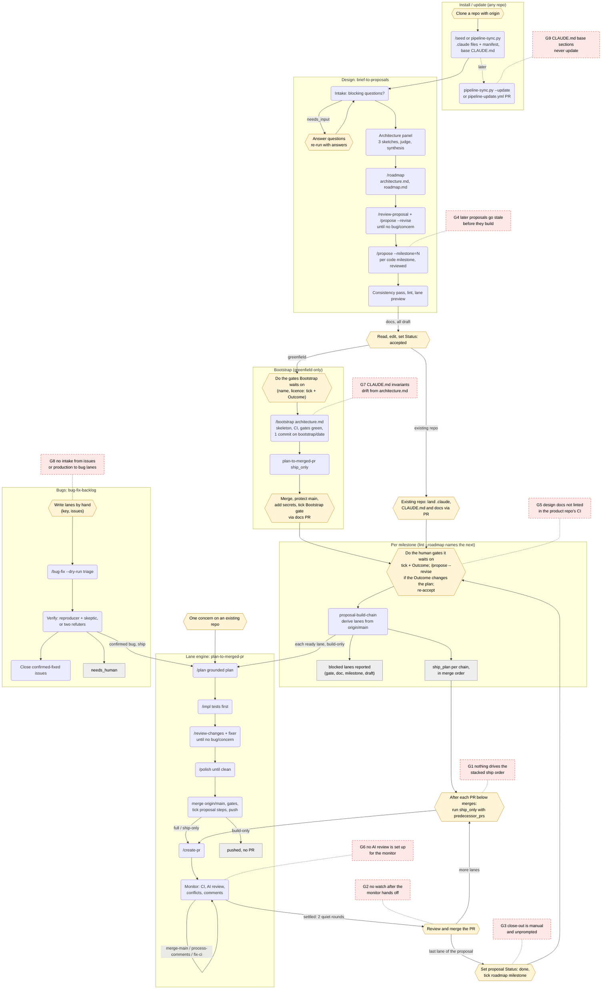

# Process

The whole pipeline as one flow: who does each step (you, a command, a workflow),
what each hand-off carries, and where the flow has gaps. The stages themselves are
described in the [README](../README.md#the-workflows); args and statuses are in
[REFERENCE.md](REFERENCE.md).

## Diagram

Rounded boxes are steps a workflow or command runs; hexagons are steps only a
person does; dashed red boxes are the gaps listed below the diagram.

## Gaps in the flow

Each gap is a hand-off where the flow depends on a person remembering a step that
nothing prompts, or where a check exists in one place but not where the edit
happens. Ordered by how often it bites.

**G1. Nothing drives the stacked ship order.** `proposal-build-chain` builds every
lane and returns a `ship_plan`, but stacked lanes must be shipped one at a time: the
person waits for each PR to merge, then runs `plan-to-merged-pr { ship_only: true }`
with the merged PR numbers filled into the `predecessor_prs` placeholder. With
several chains of three or four lanes, that is a lot of manual sequencing and the
most likely place for a lane to be forgotten.
*Fix:* a `ship-chain` mode (or workflow) that takes one `ship_plan` chain, ships the
first lane, monitors it until it reads `MERGED`, then fills `predecessor_prs` and
ships the next, stopping on anything other than `MERGED`.

**G2. No watch after the monitor hands off.** The monitor stops after two quiet
rounds with green CI, or after `max_monitor_rounds` (default 10), and leaves the PR
to the person. A review comment, a conflict from `main` moving, or CI turning red
after that point is not picked up until someone re-runs monitor-only mode
(`{ pr, branch, dir }`).
*Fix:* document the monitor-only re-run in the hand-off message and in `/create-pr`'s
report; better, a scheduled task that re-runs monitor-only on the pipeline's open
PRs.

**G3. Close-out is manual and unprompted.** When a proposal's last lane merges, a
person must set `Status: done` and tick its roadmap milestone. The lint warns
`milestone_complete_unticked` only when someone runs `proposal-lint.py --roadmap`,
and no workflow knows it just shipped the last lane. Dependants still unblock (a
milestone counts as satisfied once its proposal is complete), so the cost is drift
in the roadmap rather than a stall, but `in-progress` → `done` is never prompted.
*Fix:* have the ship-only result say when every step of the proposal is ticked on
`main`, and print the close-out edits and the next milestone (`--roadmap`'s `next`).

**G4. Later proposals go stale before they build.** `brief-to-proposals` writes a
proposal for every pending code milestone at once. By the time milestone 4 builds,
milestones 2 and 3 have changed the tree, but nothing re-reviews milestone 4's
proposal against today's code; only `/plan` grounds each lane, after the doc is
accepted, so a wrong `Files:` list or a changed interface surfaces as a stalled lane
instead of a review finding.
*Fix:* re-run `/review-proposal <doc>` (it checks the doc against the tree) before
accepting each milestone after the first, or propose only the next milestone
(`max_milestones: 1`) and propose the rest as they come up.

**G5. Design docs are not linted in the product repo's CI.** The pipeline's own CI
lints its examples, but `/bootstrap`'s CI template runs only `QUALITY_GATES`. Every
edit a person makes to the docs (accepting, ticking a gate, writing an `Outcome:`)
lands through a docs PR that nothing checks; a malformed tick shows up later as
`proposal_lint_errors` when a build starts.
*Fix:* add a `docs` job to the CI template that runs `proposal-lint.py` on every doc
in `PROPOSALS_DIR` (and `--roadmap` on the roadmap), and require it on `main`.

**G6. No AI review is set up for the monitor.** The monitor waits for the
`ai_review_check` before counting comments, but neither `/seed` nor `/bootstrap`
installs a reviewer, and the default is none. Without one, the only independent
review is `/review-changes` before the PR; the monitor only reacts to human
comments and CI. This repository runs `answerable-ai-review.yml` on its own PRs but
does not offer it to users.
*Fix:* ship that workflow as an example, have `/bootstrap`'s next steps offer it
(with the secret to add by name), and pass its check name (`Review`) as
`ai_review_check` in the ship plan.

**G7. `CLAUDE.md` invariants drift from `architecture.md`.** `/bootstrap` copies
`## Invariants` and `## Testing` from the architecture into `CLAUDE.md` verbatim.
When the architecture is revised later, `/propose --revise` only reports that
`CLAUDE.md` needs the same change; nothing makes it, and nothing checks the two
agree. Every agent reads `CLAUDE.md`, so a stale copy steers every later lane.
*Fix:* a lint check (in the G5 CI job) that the two bodies match, or keep the rules
only in the architecture and point `CLAUDE.md` at it.

**G8. No intake from issues or production to bug lanes.** `bug-fix-backlog` needs
lanes written by hand (`{ key, issues }`), grouping by shared code site is the
person's job, and nothing routes CI failures on `main`, incidents or user reports
into issues. Releases are deliberately human gates, so there is also no
post-release step at all.
*Fix:* a triage step that lists open bug issues, groups them by the code they touch
and proposes the `lanes` for the person to confirm.

**G9. `CLAUDE.md`'s base sections never update.** Pipeline updates (below) change
the commands, but `## How work happens here`, written once by `/seed`, is never
refreshed, so a repository seeded early keeps the rules of the pipeline it started
with.
*Fix:* mark the section (as the Pipeline config is marked) so a later sync can show
a diff against the current template; until then, compare it by hand after a large
update.

### Fixed: keeping the pipeline current

Before `pipeline-sync.py`, the only update path was `/seed --update` from a fresh
clone. It replaced every differing file, so a local edit to a command was silently
lost; it never deleted a file the pipeline had removed or renamed, so stale commands
stayed callable; and it recorded no version, so a repository could not tell which
pipeline it ran or whether it was behind. `pipeline-sync.py` now records the
installed commit and a hash per file in `.claude/pipeline-manifest.json` and
compares three ways (see [REFERENCE.md](REFERENCE.md#install-and-configuration)), and
[`examples/pipeline-update.yml`](../examples/pipeline-update.yml) opens a weekly PR
with the update. Two parts are still open: the pipeline publishes no release tags,
so `PIPELINE_REF` can only track `main` or pin a commit; and G9 above.
